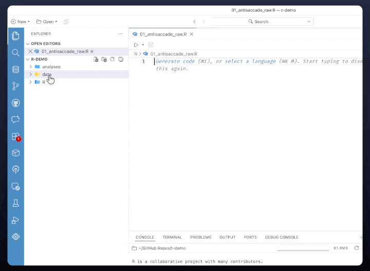
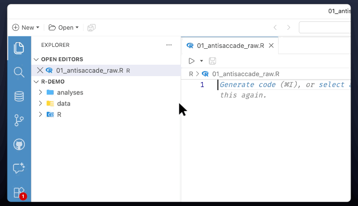

# Positron {.unnumbered}

While R is the programming language that you will be using, Positron is the software that you will use to write and run R code. It provides a user-friendly interface for writing and running R code, managing files and projects, and visualizing data. It also includes features such as syntax highlighting, code completion, and debugging tools that make it easier to write and troubleshoot R code.

Open Positron and go through the Welcome Tour and Setup Guides to get familiar with the interface and features.

## Configure Positron

Have a lab member or Dr. Tsukahara walk you through the Positron interface, and help you configure the settings to match the lab's workflow. The following sections provide a summary of the recommended settings.

### Install Extensions

To install an extension, click the **Extensions** icon (left sidebar) and search for the extension name.

Feel free to explore the available extensions, but the following are recommended for our lab workflow:

- **Fira Code** — a fancy monospaced font with ligatures (e.g., `!=` becomes ≠).
- **Material Icon Theme** — icon themes change the look of folders and files.
- **One Dark Pro** — a dark theme for your IDE.
- **GitHub Theme** — a light theme for your IDE.
- **vscode-pets** — adds a cute pet to your IDE.

### Modify Settings

- Press <kbd>⌘</kbd>+<kbd>,</kbd> (macOS) or <kbd>Ctrl</kbd>+<kbd>,</kbd>
	(Windows/Linux), or click the gear icon (bottom-left) → **Settings**.
- In the Settings window, click the **Search settings** bar at the top and type in the name of the setting you want to change. The list of settings will filter as you type.

#### Files & whitespace

| Setting | Search for | Action |
|---|---|---|
| Files: Associations | `files associations` | Click **Add Item** → Item: `renv.lock`, Value: `json` |
| Files: Trim Trailing Whitespace | `trim trailing` | Check |
| Files: Insert Final Newline | `insert final newline` | Check |
| Files: Trim Final Newlines | `trim final newlines` | Check |

#### Editor

| Setting | Search for | Action |
|---|---|---|
| Editor: Font Family | `font family` | Set to `Fira Code` (keep existing fallbacks after it) |
| Editor: Font Ligatures | `font ligatures` | Check |
| Editor: Font Size | `editor font size` | Set to `14` |
| Editor: Format On Type | `format on type` | Check |
| Editor: Tab Size | `tab size` | Set to `2` |
| Editor: Detect Indentation | `detect indentation` | **Uncheck** |
| Editor: Auto Indent | `auto indent` | Dropdown → `full` |
| Editor: Wrapping Indent | `wrapping indent` | Dropdown → `indent` |
| Editor: Default Formatter | `default formatter` | Dropdown → **Positron R** (`positron.positron-r`) |

#### Quarto

| Setting | Search for | Action |
|---|---|---|
| Quarto › Cells › Background: Color | `quarto background color` | Dropdown → `useTheme` |
| Quarto › Visual Editor: Markdown Wrap | `quarto markdown wrap` | Dropdown → `sentence` |
| Quarto › Visual Editor: Default List Spacing | `quarto list spacing` | Dropdown → `tight` |

#### Positron & keybindings

| Setting | Search for | Action |
|---|---|---|
| Positron › Assistant: Enable | `positron assistant enable` | Check |
| Workbench › Keybindings: Rstudio Keybindings | `rstudio keybindings` | Check |

#### Workbench, window & appearance

| Setting | Search for | Action |
|---|---|---|
| Workbench: Startup Editor | `startup editor` | Dropdown → `readme` |
| Symbols: Hides Explorer Arrows | `hides explorer arrows` | **Uncheck** (needs Symbols extension) |
| Window: Restore Windows | `restore windows` | Dropdown → `none` |
| Window: Close When Empty | `close when empty` | Check |

**Icon theme** (`vscode-icons`): set this via the picker rather than search —
open the Command Palette (<kbd>⌘</kbd>+<kbd>⇧</kbd>+<kbd>P</kbd> on macOS or
<kbd>Ctrl</kbd>+<kbd>⇧</kbd>+<kbd>P</kbd> on Windows/Linux) → **Preferences: File Icon
Theme** → choose **VSCode Icons**.

#### ## Git & GitHub

| Setting | Search for | Action |
|---|---|---|
| Git: Autofetch | `git autofetch` | Check |
| Git: Enable Smart Commit | `smart commit` | Check |
| Git: Confirm Sync | `confirm sync` | **Uncheck** |
| GitHub › Copilot › Next Edit Suggestions: Enabled | `next edit suggestions` | Check (needs Copilot extension) |

#### Special cases

**Markdown-only whitespace override** (`"[markdown]": { trimTrailingWhitespace:
false }`): in the Settings search bar type `@lang:markdown`, find **Trim Trailing
Whitespace**, and **uncheck** it. The funnel scopes that single change to
Markdown only and writes the language block for you.

**Editor: Rulers** (`[80]`): this array has no graphical control. Searching for
`rulers` only offers an **Edit in settings.json** link, so this one entry must
stay in JSON — add `"editor.rulers": [80]`.

## Projects

A project is a folder on your computer that contains all the folders and files related to a specific project or study. In Positron, you can create a project workspace simply by opening a folder in Positron – nothing else required. Once you open a folder in Positron, it will be treated as a project workspace, and you can start working with the files and folders within that folder. The next time you open Positron, it will provide a list of recently opened folders, allowing you to quickly access your project workspaces.

**Go ahead and create a new project folder on your computer for this useRguide.** You can name the folder something like `calmlab_useRguide`. Once you have created the folder, open it in Positron to start working on the useRguide.

## Manage Folders and Files

You can manage your folders and files directly in Positron itself. You can create new folders and files, rename them, move them around, and delete them as needed. You can also open different file types, beyond R scripts, such as PDFs and images, directly in Positron. You can also use the built-in file explorer to navigate through your project folders and files.

### Create Folders

{width=40% fig-align="left"}

### Create Files

{width=60% fig-align="left"}
