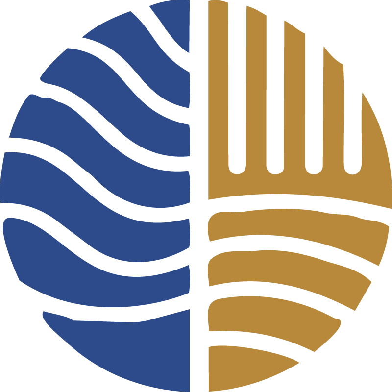

# Welcome {.unnumbered}

{.calm-lab-mark width=140}
This is the **useRguide** for the **CALM Lab**. It is intended to be a resource for new lab members to get up to speed with the tools and workflows that we use in the lab. It is also a reference for existing lab members to refresh their knowledge or learn new skills. We also hope that this guide will be useful for the broader research community, as we share our tools and workflows to promote reproducible research practices.

### Reproducible Research

An important part of the lab culture is the emphasis on reproducible research. This means that we strive to make our research as transparent and reproducible as possible, so that others can verify our results and build upon our work. Using tools like R, we can create scripts that document our data analysis workflows, making it easier to reproduce our results. 

### Sharing Tools and Workflows

The CALM Lab also values sharing tools and workflows with the broader research community. We encourage lab members to share their code, data, and methods with others, so that we can all learn from each other and improve our research practices.

#### R Packages

The lab uses a variety of R packages to facilitate our research. Some of the key packages we use include:
